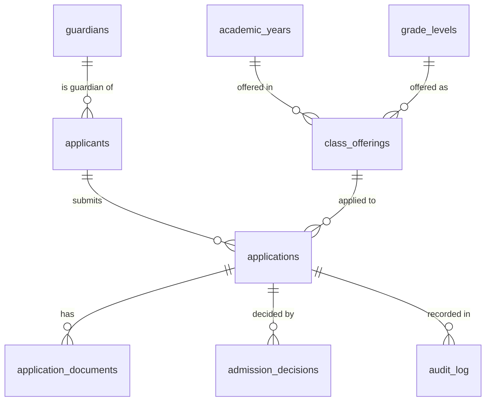

# School Enrolment Records API

**Problem:** school admissions records are inconsistent.
**What this builds:** a REST API that makes applicant registration, eligibility validation, admission
decisions and audit history consistent and traceable.

**Stack:** Java 17 · Spring Boot 3.3 · PostgreSQL · SQL (Flyway migrations) · Git

---

## Quick start

Requirements: JDK 17+, Maven 3.9+, Docker (for PostgreSQL).

```bash
docker compose up -d                                   # PostgreSQL on :5432
mvn spring-boot:run -Dspring-boot.run.profiles=demo    # loads sample reference data
./scripts/demo.sh                                      # in another terminal: scripted walkthrough
```

The demo script uses the seeded 2-seat class `PRI1`, so run it once per fresh database
(`docker compose down -v && docker compose up -d` resets it).

Run the tests:

```bash
mvn test
```

* Unit and HTTP-layer tests need nothing else.
* `EnrolmentFlowIntegrationTest` runs the whole workflow against a real PostgreSQL via Testcontainers.
  It is skipped automatically if Docker is not running.

Configuration (environment variables): `DB_URL`, `DB_USER`, `DB_PASSWORD`, `PORT`.

---

## The workflow

```
            register                eligibility-check              decision
 (none) ───────────────▶ SUBMITTED ───────────────▶ UNDER_REVIEW ─────────────▶ ADMITTED
                              │                          │   ▲                  REJECTED
                              │                          ▼   │                  WAITLISTED ──▶ ADMITTED / REJECTED
                              └──────────────────────▶ (decision) ◀─ add document resets eligibility to PENDING

 withdraw: allowed from every state except REJECTED / WITHDRAWN (an ADMITTED place is released)
```

1. **Applicant registration:** `POST /api/applications` stores guardian, applicant, the chosen
   grade/year and the documents handed in. Status `SUBMITTED`, eligibility `PENDING`.
2. **Eligibility validation:** `POST /api/applications/{id}/eligibility-check` runs the rules and
   returns a pass/fail reason per rule (age on the first day of the academic year, required documents
   for the grade, previous school where required). Sets eligibility to `ELIGIBLE` / `INELIGIBLE`.
3. **Admission decision:** `POST /api/applications/{id}/decision` with `ADMITTED`, `WAITLISTED` or
   `REJECTED` and a mandatory reason. Admit/waitlist requires `ELIGIBLE`; admit also requires a free seat.
4. **Audit history:** every change writes an audit row in the same transaction.
   `GET /api/applications/{id}/audit` returns who did what, when, and from/to which state.

## Endpoints

| Method | Path | Purpose |
|---|---|---|
| GET | `/api/academic-years`, `/api/grade-levels` | Reference data |
| GET | `/api/offerings` | Grades offered per year with live seat counts |
| POST | `/api/applications` | Register an application (201 + `Location`) |
| GET | `/api/applications?status=&academicYearId=&gradeLevelId=&page=&size=` | Search (paged) |
| GET | `/api/applications/{id}` | One application with documents |
| POST | `/api/applications/{id}/documents` | Add a late document (resets eligibility to `PENDING`) |
| POST | `/api/applications/{id}/eligibility-check` | Run eligibility rules |
| GET | `/api/applications/{id}/document-review` | Optional advisory document checker (see below) |
| POST | `/api/applications/{id}/decision` | Admit / waitlist / reject |
| POST | `/api/applications/{id}/withdraw` | Withdraw |
| GET | `/api/applications/{id}/decisions` | Decision history |
| GET | `/api/applications/{id}/audit` | Audit history |

Send `X-Actor: <name>` on write requests; it is recorded in the audit trail (see *Limitations*).
`requests.http` has ready-made requests for IntelliJ / VS Code.

Errors use one shape everywhere (RFC 9457 problem details):

| Status | Meaning |
|---|---|
| 400 | Validation failed: body has an `errors` map of `field → message`; also malformed JSON / bad enum |
| 404 | Application / year / grade not found |
| 409 | Conflict: duplicate open application, class full, concurrent edit |
| 422 | Business rule: closed intake, wrong status for this action, not eligible |

---

## Data model (the main challenge: normalised tables)



Schema is in `src/main/resources/db/migration/V1__init_schema.sql`.

| Decision | Why |
|---|---|
| `class_offerings` (grade × year) holds capacity | Capacity belongs to a grade *in a year*, not to either alone; keeps tables in 3NF |
| Age rules live on `grade_levels`, cut-off on `academic_years` | Rules are data, not code; changing them needs no deploy |
| Guardian stored once, unique by lower-cased email | Siblings share one guardian record instead of duplicating contact details |
| `UNIQUE (application_id, doc_type)` | A document type can only be received once per application |
| Partial unique index on `(applicant_id, offering_id) WHERE status NOT IN ('REJECTED','WITHDRAWN')` | One *live* application per applicant per class; re-applying after rejection stays possible |
| `CHECK` constraints on statuses, ages, capacity | The database rejects bad data even if a bug bypasses the API |
| `admission_decisions` is a history table | A waitlisted-then-admitted applicant keeps both decisions |
| `audit_log` has a trigger that blocks `UPDATE`/`DELETE` | Audit history is append-only at the database level, not just by convention |
| Flyway owns the schema; Hibernate `ddl-auto: none` | Schema changes are reviewed, versioned SQL |

## Design decisions

* **Validation in two layers.** Bean Validation on the request DTOs (shape: required fields, email,
  phone, date in the past) and business rules in services (open intake, duplicate application, eligibility,
  capacity). Database constraints are the last line of defence.
* **Eligibility is pure.** `EligibilityService` has no database access or side effects, so each rule is a
  plain unit test. It returns *why* each rule passed or failed, not just a boolean.
* **No oversold seats.** Admitting takes a row lock on the class (`SELECT … FOR UPDATE`), then counts
  admitted applicants, so two concurrent admissions to the last seat cannot both succeed.
  `@Version` optimistic locking also stops two staff members silently overwriting each other (409).
* **Audit is atomic.** `AuditService.record` is `Propagation.MANDATORY`: it can only run inside the
  transaction of the change it describes. No change without an audit row, no audit row without a change.
* **Entities never leave the service layer.** Controllers exchange DTO records only; `open-in-view` is off.
* **Decisions are final where they should be.** `REJECTED` and `WITHDRAWN` are terminal; an `ADMITTED`
  place can be withdrawn, which releases the seat.

## Optional AI implementation: enrolment document checker (rule-based option)

`GET /api/applications/{id}/document-review` flags missing or inconsistent applicant information for
**staff review**. It compares names and dates written on documents with the application:
missing required documents, name mismatch / partial match (order, case, accents and middle names are
ignored), birth-certificate date vs date of birth, and missing previous school.

* **Advisory only:** it never changes status and never makes a decision.
* **Uncertainty is surfaced, not hidden:** when a document has no recorded name/date it is flagged
  `UNVERIFIED_*` rather than silently passed. The overall result is `NO_ISSUES_FOUND` or
  `NEEDS_STAFF_REVIEW`; it never says "verified".
* **Swappable:** `DocumentReviewer` is an interface. An API-integrated implementation (text-generation
  model) can replace `RuleBasedDocumentReviewer` as a drop-in `@Component`. It should receive only
  the approved fields, return structured JSON, be validated server-side, and route uncertain results to staff.

## Project layout

```
src/main/java/com/school/enrolment
├── domain/       JPA entities and enums
├── repository/   Spring Data repositories (locking query, specifications, entity graphs)
├── service/      ApplicationService, EligibilityService, DocumentReviewer, AuditService
├── web/          controllers, DTO records, global exception handler
└── exception/    ApiException (maps business failures to HTTP status)
src/main/resources/db/migration   V1__init_schema.sql
src/main/resources/db/seed        V100__demo_reference_data.sql   (demo profile only)
src/test/java                     unit, HTTP-layer and Testcontainers integration tests
```

## Limitations and next steps

* **No authentication.** `X-Actor` is a stand-in; production should take the actor from the
  authenticated principal (Spring Security) and restrict who may decide.
* Documents are recorded as metadata only; there is no file upload/storage.
* Reference data (years, grades, capacities) is seeded/SQL-managed; there are no admin endpoints for it.
* Emails/notifications to guardians are not sent.
